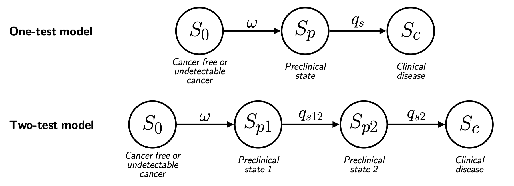

# Multi-agent AI for designing screening strategies in early cancer detection

Research code accompanying the manuscript **“Multi-agent AI for designing
screening strategies in early cancer detection”** by Maria Sol Rosito and
Giovanni Parmigiani.

This repository connects an agentic literature-review workflow implemented with
the OpenAI Responses API to cancer natural-history and screening
microsimulations in R. The agentic workflow can propose candidate screening
strategies or identify candidate model parameters and return them in structured
tables for review before simulation.

The agentic workflow uses OpenAI models in three roles. The **Proposer** searches for relevant literature and develops or refines a candidate answer to the user’s task. The **Critic** evaluates the proposal for evidentiary support and internal consistency, returning feedback when revisions are needed. The Proposer and Critic alternate until the Critic agrees or the maximum number of rounds is reached. The **Summarizer** then converts the final Proposer response into a structured parameter table. It extracts the reported results rather than developing a new solution.

Live agent runs require internet access and an OpenAI API key. The R simulation
functions, curated manuscript inputs, and saved reference outputs can be used
without making an OpenAI API call.

This is research software. Agent-generated strategies and parameters require
source verification and scientific and clinical review. They are not clinical
recommendations, and this repository is not intended for clinical
decision-making.

## Modeling framework

### Natural-history models

<p align="center">
  
</p>

<p align="center"><em>Natural-history structures used by the one-test and two-test simulations. A <a href="man/figures/natural_histories.pdf">PDF version</a> is also available.</em></p>

The one-test model follows the progression

```text
S0 -> Sp -> Sc
```

where `S0` denotes cancer-free or not yet screen-detectable disease, `Sp` is the
asymptomatic screen-detectable state, and `Sc` is the clinical state, entered at symptomatic diagnosis in the absence of screening.

The **sojourn time** is the time spent in a preclinical, screen-detectable state
before the cancer would be clinically diagnosed in the absence of screening.
The mean of this duration is the mean sojourn time (MST).

The two-test model divides the preclinical period into two ordered states:

```text
S0 -> Sp1 -> Sp2 -> Sc
```

A monotonic detectability scenario is assumed: once cancer becomes detectable by a test, it remains detectable by that test as it progresses through subsequent preclinical states. Accordingly, Test 1 can detect cancer in both `Sp1` and `Sp2`, whereas Test 2 can detect it only in `Sp2`. Every simulated cancer follows the same ordered state sequence.

### Screening models

The natural-history simulation first generates latent disease trajectories. Screening is then simulated by overlaying test schedules and test-performance parameters on those trajectories. The one-test model uses one screening schedule. In the two-test model, the starting age, stopping age, interval, sensitivity, and specificity are specified separately for each test; the two schedules may overlap. The screening functions return detection status and age, lead time, screening administrations, and false-positive results.

The main model functions are:

- [`natural_history_simulation_one_test()`](R/natural_history_simulation_one_test.R)
- [`lead_time_one_test()`](R/lead_time_one_test.R)
- [`natural_history_simulation_two_test()`](R/natural_history_simulation_two_test.R)
- [`lead_time_two_test()`](R/lead_time_two_test.R)

Important conventions include:

- Penetrance is the age-specific probability of entering the clinical state; it
  is not cumulative risk.
- Sojourn times follow exponential distributions and may use either a single MST
  or age-band-specific MSTs.
- Lead time is the counterfactual clinical age minus the screening-detection age.
  It is zero for a known clinical case not detected through screening and `NA`
  when the clinical age is unknown.
- Repeated screening outcomes are conditionally independent, and false-positive
  results do not interrupt future screening.

Additional state-specific assumptions, return values, and boundary conventions
are documented in the corresponding R files.

## Agentic templates

In this repository, a **template** is a task configuration for the agentic
workflow. It specifies the information supplied by the user, the instructions
followed by the Proposer and Critic, and the row and column structure produced by
the Summarizer. A template is therefore not the natural-history model itself;
it connects a defined evidence task to the inputs required by that model.

The available templates are registered in
[`templates/templates.json`](templates/templates.json).

| Template | User supplies | Primary quantities returned |
|---|---|---|
| `one_test_model` (Template 1) | Cancer, target population, and screening test | Age-specific MST estimates when available, a recommended single MST, sensitivity, and specificity |
| `two_test_model` (Template 2) | Cancer and target population | Two tests consistent with the monotonic detectability model and a screening start age, stop age, and interval for each test |

The templates can be used independently or composed. For example, in a two-test analysis, Template 2 can define the tests and schedules, after which Template 1 can be
applied separately to obtain natural-history and test-performance parameters for
each test.

## How the components connect

```text
User request + task-specific template
                 |
                 v
        Proposer <-> Critic
                 |
                 v
             Summarizer
                 |
                 v
       structured parameter CSV
                 |
                 v
           R parameter parsing
                 |
                 v
 natural-history and screening simulation
                 |
                 v
 simulated trajectories and screening outcomes
```

The structured output can be reviewed and passed to the R simulations; the agentic workflow proposes candidate inputs but does not itself run or validate the simulations.

## Repository structure

```text
.
├── R/                                  # Simulation and R interface functions
├── python/
│   └── two_agent_system_parameters_csv.py
├── templates/                          # Template registry and agent prompts
├── scripts/
│   └── two_test_full.R                 # Manuscript case-study simulation
├── vignettes/
│   └── whole_workflow.Rmd              # Parameterized end-to-end workflow
├── data/
│   └── paper_case_study/
│       ├── agent_generated_inputs/     # Curated parameter CSVs
│       ├── simulation_inputs/          # Penetrance input for the case study
│       └── reference_outputs/          # Saved simulation objects
├── man/
│   └── figures/                        # README and manuscript figures
├── logs/                               # Local agent runtime records (ignored)
└── results/                            # Locally generated simulations (ignored)
```

The project is currently organized as source-based research code rather than an
R package. Run the examples from the repository root and source the required R
files before calling their functions.

## Whole-workflow vignette

The parameterized [`whole_workflow.Rmd`](vignettes/whole_workflow.Rmd) vignette
shows the composition of Templates 1 and 2, constructs the simulation inputs,
and produces selected natural-history and screening plots. Before rendering,
the user can choose between live agent calls and the frozen manuscript tables,
and between rerunning the simulations and reading the saved reference objects.
The defaults use frozen inputs and reference objects and therefore make no API
calls and do not rerun the million-history simulation. Live mode additionally
requires explicit confirmation that API calls may be billable. Alternative HTML
renderings can be kept locally under `vignettes/rendered/`, which is ignored by
Git.

```r
dir.create(
  file.path("vignettes", "rendered"),
  recursive = TRUE,
  showWarnings = FALSE
)
rmarkdown::render(
  "vignettes/whole_workflow.Rmd",
  output_file = "frozen_reference.html",
  output_dir = file.path("vignettes", "rendered")
)
```

## Requirements

### Python and OpenAI API

Python 3.11 or later is recommended. Install the required packages with:

```bash
python3 -m pip install openai pandas striprtf
```

`striprtf` is needed only when a problem description is supplied as an RTF file.
The workflow is currently configured to use `gpt-5.5` through the OpenAI
Responses API. Web search is enabled for the Proposer and Critic. A live run
therefore requires API access to the configured model and sufficient API credits.

Set the API key in the environment rather than placing it in a script:

```bash
export OPENAI_API_KEY="your-key-here"
```

### R

The simulation code primarily uses base R. The `nnls` package may be needed for
some combinations of simulation inputs:

```r
install.packages("nnls")
```

Rendering the whole-workflow vignette additionally requires `rmarkdown`:

```r
install.packages("rmarkdown")
```

`Fam3PRO` is an R package for multi-gene, multi-syndrome cancer-risk modeling
from family history, developed by the [BayesMendel Lab](https://hsph.harvard.edu/research/bayesmendel-lab/). This repository uses its `Fam3PRODatabase` data object as a
source of cancer penetrance either for the general population or for genetic mutation carriers. Both natural-history functions can instead accept a user-supplied penetrance vector, in which case `Fam3PRO` is not required. When no vector is supplied, `Fam3PRODatabase` must be loaded in the R session.

## Running the agentic workflow

### Interactive use

```bash
python3 python/two_agent_system_parameters_csv.py
```

The script prompts for a problem description and one of the registered template
names. The problem can be entered directly or read from a TXT or RTF file.

### Non-interactive use

Template 1 example:

```bash
python3 python/two_agent_system_parameters_csv.py \
  --non_interactive \
  --template one_test_model \
  --problem "Estimate parameters for colorectal cancer screening with colonoscopy in the female population."
```

Template 2 example:

```bash
python3 python/two_agent_system_parameters_csv.py \
  --non_interactive \
  --template two_test_model \
  --problem "For colorectal cancer in the female population, identify two clinically relevant asymptomatic screening tests consistent with the monotonic two-test model, and propose one literature-grounded candidate screening strategy for each test, consisting of a screening start age, stop age, and fixed interval."
```

Each run creates timestamped files in `logs/`:

- `parameters_YYYYMMDD_HHMMSS.csv`: the structured parameter table;
- `problem_YYYYMMDD_HHMMSS.txt`: the supplied problem statement;
- `conversation_YYYYMMDD_HHMMSS.txt`: the full agent interaction record.

The contents of `logs/` are ignored by version control. The selected inputs used
in the manuscript example are stored separately under
`data/paper_case_study/agent_generated_inputs/`.

Log files contain the complete user prompt and model-generated content.

### Calling the workflow from R

```r
source(file.path("R", "run_agentic_parameters.R"))

agent_run <- run_agentic_parameters(
  problem_text = paste(
    "Estimate parameters for colorectal cancer screening with FIT",
    "in the female population."
  ),
  template = "one_test_model"
)

agent_run$parameters
agent_run$csv_path
```

Live agentic calls are not deterministic: model updates, retrieved sources, and
stochastic generation may change their outputs. Preserve selected parameter
files and the supporting records for analyses that must be reproduced.

## Running the R models without an agentic call

This small one-test example uses an illustrative penetrance vector and therefore
does not require API access or `Fam3PRO`. The vector demonstrates the software
interface and is not an empirical cancer-risk estimate.

```r
r_files <- list.files("R", pattern = "[.]R$", full.names = TRUE)
invisible(lapply(r_files, source))

penetrance <- rep(0.001, 94)

set.seed(1001)
natural_history <- natural_history_simulation_one_test(
  cancer = "Example",
  gene = "Example",
  sex = "All",
  MST = 5,
  nsamples = 1000,
  verbose = FALSE,
  penetrance = penetrance
)

lead_time_results <- lead_time_one_test(
  natural_history = natural_history,
  Delta_t = 1,
  sensitivity = 0.75,
  specificity = 0.90,
  age_min = 40,
  age_max = 70,
  seed = 1002,
  verbose = FALSE
)

```

## Manuscript case study and reference data

The manuscript case study considers colorectal cancer in a female population.
The selected strategy combines colonoscopy every 10 years with annual fecal
immunochemical testing from ages 45 through 75.

The curated agent-generated inputs are stored in
[`data/paper_case_study/agent_generated_inputs/`](data/paper_case_study/agent_generated_inputs/):

| File | Role in the case study |
|---|---|
| [`parameters_20260819_154630.csv`](data/paper_case_study/agent_generated_inputs/parameters_20260819_154630.csv) | Two-test strategy generated with Template 2 |
| [`parameters_20260814_195949.csv`](data/paper_case_study/agent_generated_inputs/parameters_20260814_195949.csv) | Colonoscopy parameters generated with Template 1 |
| [`parameters_20260814_190648.csv`](data/paper_case_study/agent_generated_inputs/parameters_20260814_190648.csv) | Fecal immunochemical testing parameters generated with Template 1 |

The reported simulation used 1,000,000 histories and fixed random seeds:

- `2782005` for the natural-history simulation;
- `2782006` for the screening simulation.

### Inspecting the saved simulation objects

The saved reference objects allow the manuscript simulation to be inspected
without rerunning the agentic workflow or the million-history simulation. They
are binary R files and should be loaded from the R console rather than opened in
the RStudio text editor:

```r
natural_history <- readRDS(
  file.path(
    "data", "paper_case_study", "reference_outputs",
    "natural_history.rds"
  )
)

lead_time_results <- readRDS(
  file.path(
    "data", "paper_case_study", "reference_outputs",
    "lead_time.rds"
  )
)

names(natural_history)
names(lead_time_results)
```

The files contain simulated histories only; they do not contain individual-level
patient data.

### Rerunning the full simulation

[`scripts/two_test_full.R`](scripts/two_test_full.R) reads the curated parameter
tables, runs the two-test natural-history and screening models, and saves the new
simulation objects. Run it from the repository root:

```bash
Rscript scripts/two_test_full.R
```

By default, the script creates `results/paper_case_study/` and writes
`natural_history.rds` and `lead_time.rds` there. The `results/` directory is
ignored by version control so that local reruns do not overwrite or add to the
curated reference outputs.

No output configuration is required for normal use. To save the results
somewhere else, set `CANCER_SCREENING_OUTPUT_DIR` for that run:

```bash
CANCER_SCREENING_OUTPUT_DIR="/path/to/output" Rscript scripts/two_test_full.R
```

<!-- The full case-study simulation requires `Fam3PRO` and can require substantial
computation time and memory. A smaller `nsamples` can be used for a smoke test;
retain 1,000,000 histories when reproducing the reported analysis.-->

Reproducing the simulation from the saved inputs is distinct from rerunning the
agentic workflow. New agentic runs may identify different sources, parameter
estimates, tests, or screening schedules.

## Research-use limitations

- The workflow assists with evidence identification and organization; it does
  not establish that an extracted estimate is valid for a particular population
  or modeling context.
- The natural-history models make simplifying assumptions, including exponential
  sojourn times, monotonic progression, and fixed ordered disease trajectories.
- Screening outcomes assume conditional independence across repeated tests and
  no change to future screening after a false-positive result.
- The two-test screening simulation assumes fixed, independently specified schedules for the two tests, each defined by a starting age, stopping age, and screening interval.
- Simulation results characterize the modeled assumptions and inputs; they do
  not by themselves establish the benefit, safety, or clinical appropriateness
  of a screening strategy.

## Citation

If you use this repository, please cite:

> Rosito MS, Parmigiani G. *Multi-agent AI for designing screening strategies in
> early cancer detection*. Manuscript, 2026.

Publication details and a persistent identifier will be added when available.

## License

A software license has not yet been added to this repository. Until one is
provided, no permissions beyond those granted by applicable law should be
assumed.
